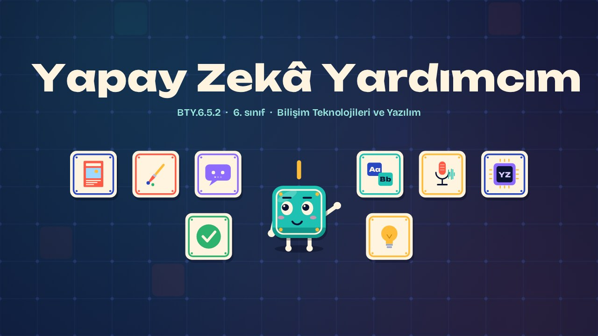
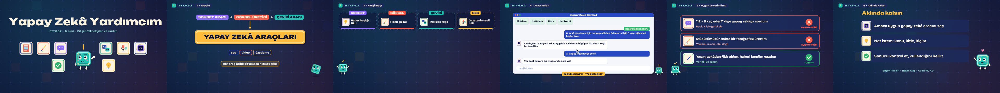

# Yapay Zekâ Yardımcım · My AI Helper

**▶ Tarayıcıda izleyin / Watch in the browser:** https://hakanatas.github.io/yapay-zeka-yardimcim/ 
**⬇ MP4 + altyazılar / MP4 + subtitles:** [Releases](https://github.com/hakanatas/yapay-zeka-yardimcim/releases) 
**✎ Kullanılan istem / The prompt behind it:** [PROMPT.md](PROMPT.md) 
**🎞 Bütün filmler / All films:** [Bilişim Filmleri](https://hakanatas.github.io/bilisim-filmleri/?sinif=6)

> **TR —** 6. sınıf Bilişim Teknolojileri ve Yazılım dersinin "Yapay Zekâ" temasındaki BTY.6.5.2 öğrenme çıktısı için hazırlanmış, tamamen JavaScript ile çizilen 2,3 dakikalık animasyon; ses efektleri ve hafif fon müziği de kodla üretilir. Farklı amaçlara hizmet eden yapay zekâ araçları tanıtılır: sohbet, görsel üretme, çeviri, ses ve video araçları. Sınıf gazetesi hazırlarken her işe uygun araç seçilir. Bir sohbet aracıyla önce belirsiz, sonra net bir istem yazılarak haber başlıkları istenir ve seçilen başlık İngilizceye çevrilir; sonuç kontrol edilir. Son olarak yapay zekâ araçlarının kullanımı uygunluk ve verimlilik açısından değerlendirilir. Altyazılar Türkçe, İngilizce ya da ikisi birlikte seçilebilir.

A 2.3-minute animation, with code-generated sound, for **6th-grade IT and Software** (Türkiye Yüzyılı Maarif Modeli). AI tools for chatting, images, translation, audio and video are introduced; the right tool is chosen for each job on a class newspaper; Karo improves a vague prompt, gets headlines, translates one and checks the result; and AI tool use is judged for suitability and efficiency. The guide is **Karo**, a living glazed tile who never speaks: he tells the story with his face, his arms and the blinking cursor above his head.

## Öğrenme çıktısı · Learning outcome

MEB, Türkiye Yüzyılı Maarif Modeli, Bilişim Teknolojileri ve Yazılım Dersi Öğretim Programı, 6. sınıf, 5. tema "Yapay Zekâ":

**BTY.6.5.2. Yapay zekâ araç ve teknolojileri ile çalışabilme**
- a) Kullanacağı yapay zekâ aracını amacına uygun olarak belirler.
- b) Belirlediği yapay zekâ aracını kullanır.
- c) Kullandığı yapay zekâ aracını uygunluk/verimlilik kapsamında değerlendirir.

## Sahneler · Scenes

| # | Zaman | Sahne | Ne oluyor | Çıktı |
|---|---|---|---|---|
| 1 | 0:00–0:16 | Giriş |  |  |
| 2 | 0:16–0:45 | Araçlar | Sohbet, görsel üretme ve çeviri araçları; ses ve video. | a |
| 3 | 0:45–1:08 | Hangi araç? | Gazete işleri için amaca uygun yapay zekâ aracı seçilir. | a |
| 4 | 1:08–1:40 | Aracı kullan | Net istem yazmak, sonucu geliştirmek ve kontrol etmek. | b |
| 5 | 1:40–2:03 | Uygun ve verimli mi? | Yapay zekâ araçlarının kullanımı uygunluk ve verimlilik açısından değerlendirilir. | c |
| 6 | 2:03–2:20 | Aklında kalsın |  |  |

## Çalıştırma · Running it

- **Önizleme:** `index.html` dosyasına çift tıklayın (çevrim dışı da çalışır). Klavye: boşluk oynat/duraklat, ← → 3 sn, Home başa. Adrese `?altyazi=en`, `?bicim=vertical` ya da `?ses=0` eklenebilir.
- **MP4:** bir kez `npm install`, sonra `npm run export -- --format=both --captions=tr` (720p yatay ve dikey, sesli). Google Chrome yüklüyse Playwright onu kullanır (`channel: 'chrome'`); ffmpeg gerekir.
- **Altyazı ve seslendirme notları:** `npm run srt` → `out/yapay-zeka-yardimcim_tr.srt`, `_en.srt`, `_tr-en.srt`, `_seslendirme-notlari.txt`.
- **Sürüm dosyaları:** `npm run release` → `release/` klasöründe v1.0'ın 6 dosyası.
- **Yazı kontrolü:** `npm run check` yatay ve dikey düzende, üç altyazı seçeneğiyle üst üste binen, kenardan taşan ya da 720p'de 17 pikselden küçük kalan yazı arar.
- **Düzenleme:** senaryo (sahneler, altyazılar, seslendirme notları) `scenes/film.js` içindedir; değiştirince `npm run build` süreleri, `captions.js` ve `film.config.js` dosyalarını yeniden üretir. Sahne şablonları `src/kit/`, Karo `src/draw/karo.js`, ses `src/audio/synth.js`.

Her kare `renderFrame(t)` ile zamanın saf fonksiyonu olarak çizilir; rastgelelik tohumludur, MP4 ekran kaydı değil kare kare üretimdir. Ses de dosyadan çalınmaz: aynı olay listesinden hesaplanır. Yazı tipleri: Unbounded ve Bricolage Grotesque (SIL OFL 1.1), dosyaya gömülü.

## Lisans · License

**TR —** Bu film ve kodu [Creative Commons Atıf-GayriTicari 4.0 Uluslararası (CC BY-NC 4.0)](https://creativecommons.org/licenses/by-nc/4.0/deed.tr) lisansıyla paylaşılır. Ticari olmayan her amaçla (derste, okulda, eğitim materyalinde) kopyalayabilir, paylaşabilir ve değiştirebilirsiniz; ancak **kaynak göstermek zorunludur**: eser sahibinin adı ve bu deponun bağlantısı belirtilmeden kullanılamaz. Ticari kullanım (satış, ücretli ürün ya da yayın) için izin alınmalıdır.

**EN —** This film and its code are licensed under [Creative Commons Attribution-NonCommercial 4.0 International (CC BY-NC 4.0)](https://creativecommons.org/licenses/by-nc/4.0/). You may copy, share and adapt them for non-commercial purposes, but **attribution is required**: they may not be used without crediting the author and linking to this repository. Commercial use requires permission.

Atıf örneği / Required credit: *“Yapay Zekâ Yardımcım”, Hakan Ataş, Bilişim Filmleri — https://github.com/hakanatas/yapay-zeka-yardimcim — CC BY-NC 4.0*
